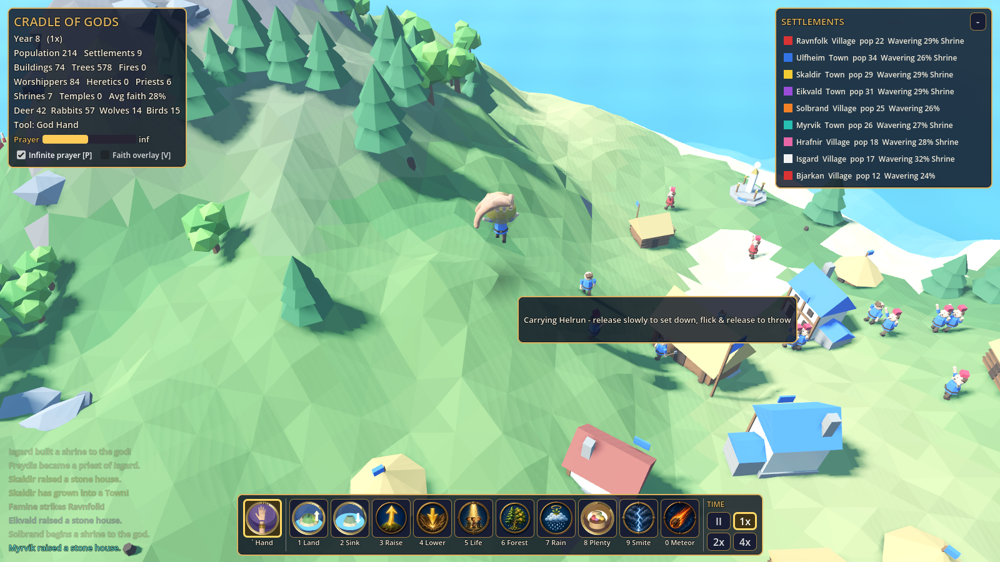

# Cradle of Gods — God Simulator

A 3D god-simulation sandbox for **Godot 4.3+ (GDScript, GL Compatibility renderer)**. You are a deity
with a physical **God Hand**: pick up villagers and animals, carry them, set them down or hurl them,
raise new land out of the ocean, and watch tribes build shrines and temples, worship you, doubt you,
and break into heresy. Inspired by the *gameplay ideas* of Black & White and Deisim VR; every line of
code and every asset in this repository was written or generated for this project.

## Open and play
1. Install Godot **4.3 or newer** (standard build, not .NET). The project was developed and tested
   with **Godot 4.7 stable**.
2. In the Project Manager click **Import**, choose `project.godot`, then **Edit**. On first open Godot
   imports the `.glb` models and icons (a few seconds).
3. Press **F5**. Click the title screen or press any key to start.

Command line: `godot --path /path/to/Cradle-of-gods`. Add `-- --seed=1234` for a fixed world seed.
The GL Compatibility renderer runs on low-end GPUs and in software (Mesa llvmpipe).

## Controls
| | Action | Input |
|---|---|---|
| **God Hand** (default tool) | Pick up a villager, animal, tree, rock or berry bush | Left-press on it and hold |
| | Carry | Move the mouse while holding |
| | Set it down gently | Release while the hand is moving slowly (the hand lowers it onto the nearest walkable ground, outside buildings) |
| | Throw | Flick the mouse and release mid-motion (release velocity = throw velocity) |
| | Gift wood / stone / food | Drop a tree, rock or bush inside a village |
| | Pull the world (pan) | Left-drag on empty ground |
| | Settlement info | Click a building |
| | Back to the hand from any power | `Esc` or `` ` `` (backquote), or click the Hand icon |
| **Camera** | Pan | `W A S D` / arrow keys (`Shift` = faster), or drag the ground with the hand |
| | Rotate | `Q` / `E`, or right- / middle-mouse drag (orbit) |
| | Zoom | Mouse wheel, or `R` / `F` |
| | Next settlement | `Tab` |
| **Powers** | Select | `1`–`9`, `0`, or click a toolbar icon |
| | Use | Left-click; hold for Create Land (brush), Remove, Raise, Lower, Forest |
| | Land mode (Brush / Tile) | `B`, or the buttons above the toolbar |
| | Brush size | `[` / `]`, or the slider above the toolbar |
| | Create Life type (villagers, deer, rabbits, wolves, birds) | `C`, or the drop-down above the toolbar |
| **Religion** | Faith overlay (gold devout, pale believer, grey doubter, white priest, purple heretic) | `V` |
| | Infinite prayer (sandbox) | `P` |
| **Time / UI** | Pause / resume | `Space` |
| | Slower / faster (paused, 1x, 2x, 4x) | `-` / `+`, or the toolbar buttons |
| | Fold the settlement list | `T` |
| | Help overlay (same bindings, in game) | `H` or `F1` |
| | Screenshot | `F12` (saved to `screenshots/`) |

### Powers
| Key | Power | Prayer | Effect |
|---|---|---|---|
| 1 | Create Land | – | **Brush mode**: paint land up out of the sea with noise-wobbled coastlines, beaches and an underwater shelf. **Tile mode**: place 6×6 tiles on a grid that join seamlessly; drag to lay a chain. |
| 2 | Remove Land | – | Return land to the ocean: channels, split islands, floods. |
| 3 / 4 | Raise / Lower | – | Sculpt hills, mountains, valleys and lakes. |
| 5 | Create Life | 15 (7.5 for animals) | 3 villagers (join a reachable tribe, or found a new one) or a pair of animals. |
| 6 | Sow Forest | 0.6 / stroke | Trees and berry bushes on fertile land. |
| 7 | Blessed Rain | 25 | Fertility, regrowth, puts out fires, blesses tribes (faster births). A strong miracle. |
| 8 | Miracle of Plenty | 20 | Food for a settlement; ends famine; doubly persuasive during a crisis. |
| 9 | Lightning | 10 | Kills, ignites trees and buildings. |
| 0 | Meteor | 60 | Crater, firestorm, destruction. |

## The systems

**World and land creation** (`terrain.gd`). A 224×224-cell heightmap; the procedural island sits
in the middle of open ocean so there is room for new islands, peninsulas, land bridges and
continents. Edits only rebuild the touched 32×32 mesh chunks; the `HeightMapShape3D` collider is
refreshed at most every 0.12 s while painting (immediately when the stroke ends). New land gets
biome colours, can be walked on, grows forests (natural spread and Sow Forest) and can be settled.

**Navigation** (`nav.gd`). Godot's native `AStarGrid2D` over the terrain vertices: water and cliffs
are solid; slopes, shorelines and building footprints cost more. Terrain edits refresh only the
edited rectangle. A flood-filled island id per cell gives instant "is this reachable?" checks, so
villagers never chase resources across the sea, and a villager the god carries to another island
joins a tribe there or founds a castaway settlement. Straight lines are used when the way is clear;
A* paths are simplified; there is a per-step path budget, stuck detection, re-planning after
terrain edits and a blacklist for unreachable targets.

**God Hand** (`god_hand.gd`, model `assets/models/god_hand.glb`). A skinned hand (Blender: voxel-
remeshed palm and fingers, 16-bone armature, nails, golden bracer) driven bone-by-bone. Finger poses
(relaxed, open, grip, claw, point, cast) blend smoothly; the hand faces the camera like Black &
White's, leans and rolls with its velocity, reaches down to grab, turns palm-down while carrying so
the creature dangles in view, and swings what it holds like a pendulum. Hover feedback: coloured ring
(gold villager, purple heretic, white priest, green animal, blue tree/rock, tribe colour for
buildings), tooltip, finger pose and glow; a blob shadow and reticle show where it is over the
ground. Thrown things follow ballistic physics: fast impacts stun or kill and crush whatever they hit;
a hurled boulder can wreck a building.

**Villagers** (`villager.gd`). Articulated bodies (legs, arms, head, torso, plus tools, spear, priest
robe and mitre, heretic hood) with blended procedural walk, work, carry, worship (kneel and raise
arms), preach, throw, cheer, panic, dangle and dazed poses. Utility AI: flee wolves and fire > worship
> priest or heretic duties > build > hunt (when food is short and game is plentiful) or gather what
the tribe needs > explore. Tribes go Camp → Village → Town, build huts and stone houses (two model
variants each, facing the hall), check the whole footprint for overlap, water and unevenness and
level the plot, emigrate under population pressure, and react to famine, disasters and miracles.

**Religion** (`religion.gd`). Each villager has *faith* and *resentment*:
- Faith rises when they **witness** miracles (rain, plenty, life, forest, land raised near them,
  gifts), from worship, sermons and missionaries, and when the god helps during a crisis (rain on a
  burning or starving village, plenty during famine).
- Resentment rises from famine and fires without divine help, wolves taking their people, the god
  smiting their kin, persuasion by heretics and long neglect.
- **Heresy has a reason**: a villager turns heretic when resentment clearly outweighs faith; the
  cause is remembered and shown ("rejects the god (famine)").
- Tribes with 3+ believers build a **shrine**; Villages/Towns with 10+ believers and stone upgrade it
  to a **temple**. Shrines appoint a **priest** (two at a temple) who leads **ceremonies** — the
  faithful walk to the shrine, kneel and pray — and preaches to doubters and heretics. Temples send
  **missionaries** to less devout neighbours. Devout towns slowly lift their neighbours.
- **Heretics** skip worship, refuse to build shrines, and try to talk believers out of their faith;
  priests try to win them back. Heresy causes **tension**: slower work, fewer births, heckled
  ceremonies, angry heretics leaving devout towns, and at 45%+ a **schism** where the heretics found
  their own settlement.
- Responding: miracles near heretics can convert them; striking heretics (lightning, a throw) cows
  other heretics and reassures believers, while striking the faithful breeds resentment in their kin.
- **Prayer power** comes from believers and above all from ceremonies; miracles cost it (terrain
  tools are free). `P` toggles infinite prayer for pure sandbox play.

**Wildlife** (`ecosystem.gd`, `animal.gd`). Deer, rabbits, wolves and birds with their own low-poly
articulated models and gaits (walk/gallop legs, rabbit hops, wing flaps, grazing heads, wagging
tails). They wander their habitats, avoid settlements, flee predators, people and fire, graze (deer
also browse berry bushes, competing with villagers), breed when fed and not overcrowded, and die of
age, starvation, drowning, predators, hunters and divine powers. Wolves hunt in packs (and, starving,
will take a lone villager); birds flock, fly and perch near trees. Villagers hunt only where game is
plentiful and with a few hunters per settlement, so populations persist over long runs.

**UI** (`hud.gd`). Stats (population, settlements, buildings, worshippers, heretics, priests, shrines,
temples, average faith, animal counts), prayer bar, sandbox and faith-overlay toggles, a compact
foldable settlement list (stage, population, devotion label, holy site, heretic warning, famine; click
to visit), a settlement panel, the toolbar (hand + 10 powers + time), land mode / brush / life-type
options, a hover tooltip, toasts, event log, help overlay and title splash.

## Code map
`main.gd` bootstrap, environment, hotkeys · `terrain.gd` heightmap, mesh chunks, land creation ·
`nav.gd` A* grid and islands · `world_sim.gd` resources, tribes, buildings, fire, hand props, spatial
hash, profiling · `villager.gd` · `religion.gd` · `ecosystem.gd` + `animal.gd` · `god_hand.gd` ·
`powers.gd` · `camera_rig.gd` · `hud.gd` · `fx.gd` · `assets.gd` · `autotest.gd` (headless
regression suite) · `shots.gd` (rendered tour, synthetic input test, scripted demo).

## Assets (all original)
- `tools/make_assets.py` (Blender 4.2, milestone 1): trees, rock, bush, hut, house, great hall,
  villager, meteor, stump. Kept unchanged.
- `tools/make_assets_v2.py` (Blender 5.2 / `bpy` module): `god_hand.glb` (skinned), `villager_rig.glb`
  (articulated parts), `deer/wolf/rabbit/bird.glb`, `shrine.glb`, `temple.glb`, `hut_b.glb`,
  `house_b.glb`. Run `python tools/make_assets_v2.py -- assets/models` (with `pip install bpy`) or
  `blender -b --python tools/make_assets_v2.py -- assets/models`.
- `tools/make_icons.py` renders the hand / land / remove / plenty toolbar icons with Cycles.
- The original seven power icons and the title splash were made with an AI image generator for the
  first milestone.

## Testing
`tools/run_tests.sh` (set `GODOT=/path/to/godot`):
1. **Headless regression suite**: `godot --headless --path . --fixed-fps 30 -- --autotest` — about
   80 checks over ~35 simulated minutes: world generation, growth, gathering, settlement progression,
   stuck villagers, raise/lower + collider, brush land from deep ocean (walkable, beach, collider),
   tiles (seams, connectivity, repeated placement), remove land (splits islands), a villager walking
   onto a new peninsula via A*, a settlement founded and built on a new island, trees on new land,
   God Hand hover/grab/carry/place/throw for villagers, a deer, and a tree gifted to a village, prayer
   costs, miracles raising faith, shrine → priest → ceremony → prayer → temple, heresy from famine and
   smiting with recorded causes, heretic persuasion, conversion by miracles, punishing a heretic,
   animal breeding, wolf predation, villager hunting, bird flight, bounded populations, every divine
   power, pause and 4x speed, and a 20-minute stability run. Exits non-zero on failure; the last log
   is `tools/last_autotest.log`.
2. **Rendered tour + synthetic input** (`xvfb-run ... -- --shots`): renders `screenshots/*.png`, then
   drives the game with OS-level input events: `W` pan, wheel zoom, right-drag orbit, **left-drag on
   the ground pans via the hand**, **mouse hover + left-press grabs a villager and a flick throws it**,
   hotkeys, a click casting a power, `B`, `]`, toolbar click, `Esc`, `Space`, `+`. Log in
   `tools/last_shots.log`.
3. `tools/record_demo.sh` records the scripted demo with Godot's movie maker (`--write-movie`).
4. `godot --headless --path . -s res://tests/profile.gd` prints per-subsystem simulation cost.

## Performance notes
Measured headless on the CI container (4 vCPU, no GPU), see `tools/last_autotest.log`: roughly
4 ms per 0.1 s simulation step at ~150 villagers and ~150 animals. Optimisations made after profiling:
spatial hashes for villager/animal neighbour queries, off-screen AI and animation LOD (half-rate
thinking, 1/6-rate pose updates for things outside the camera frustum), packed node references for
pose application, native A* with a path budget, throttled collider and island updates, distance-based
`visibility_range` on character parts. Rendering under the software renderer is ~2 FPS at 1600×900;
real-GPU frame rates have not been measured here.

## Known limitations
- No save/load, audio, boats, war or diplomacy (warfare was out of scope by design).
- Villagers path on a 1 m grid; dense building clusters can produce small detours.
- Tile mode makes square-edged islands by design; use the brush for organic coasts.
- Only measured under software rendering; GPU performance is unverified.
