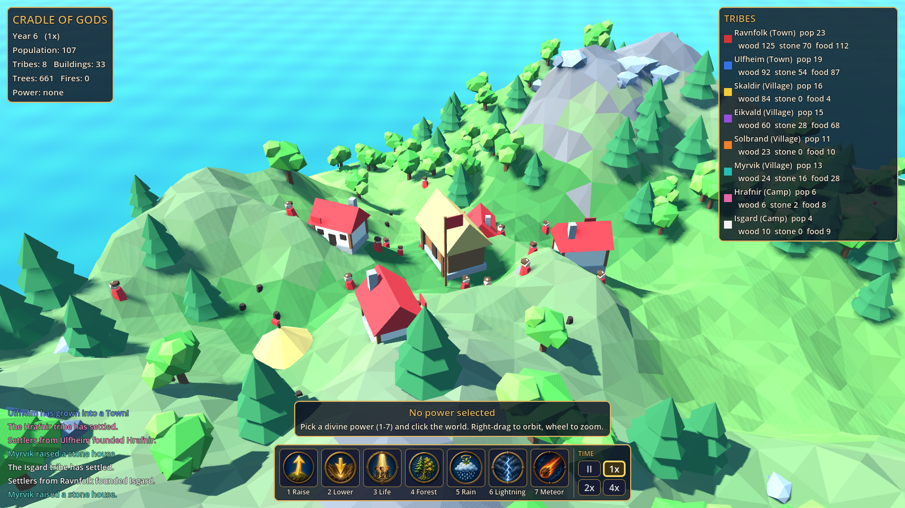

# Cradle of Gods (God Simulator, milestone 1)

A clean-room 3D god-simulation sandbox for **Godot 4.3+ (GDScript)**, inspired by the *gameplay ideas* of
Deity VR and WorldBox. No code or assets come from any other project. Everything here was written or
generated for this repo.

## Open and play
1. Install Godot **4.3 stable** or newer (standard build, not .NET).
2. In the Project Manager, click **Import**, pick `project.godot` in this folder, then click **Edit**.
   On first open, Godot imports the `.glb` models and the PNG icons (a few seconds).
3. Press **F5** (Run Project). Click the title screen, or press any key, to start.

From the command line: `godot --path /path/to/god-sim`. Add `-- --seed=1234` to pick the world seed
(by default each run gets a random world).

The project uses the **GL Compatibility** renderer, so it runs on low-end GPUs and in software (Mesa llvmpipe).

## Controls
| Action | Input |
|---|---|
| Pan camera | WASD / arrow keys (Shift = faster) |
| Rotate | Q / E, or **right- or middle-mouse drag** (orbit) |
| Zoom | Mouse wheel, or R / F |
| Jump to next tribe | Tab |
| Select power | 1–7, or click a toolbar icon (Esc deselects) |
| Use power | Left click. Hold the button for Raise, Lower and Forest |
| Brush size | [ and ] |
| Time | Space = pause/resume, - / + = slower/faster, or the II / 1x / 2x / 4x buttons |
| Help overlay | H or F1 |
| Screenshot | F12 (saved to `screenshots/`) |

## Features
- **Procedural world**: a 161×161 noise heightmap island with ridged mountains. It's a flat-shaded low-poly
  mesh split into 25 chunks, with per-triangle biome colours: deep and shallow sea, beach, dry savanna,
  grassland, forest, alpine, rock and snow. There's also an animated transparent water shader and a sea floor.
  A `HeightMapShape3D` collider is rebuilt along with the mesh after every edit.
- **Nature**: about 650 trees (pine and oak), rocks and berry bushes, drawn with MultiMesh.
  Forests spread on their own and bushes regrow. Fertility affects both, and blessing or scorching changes the
  terrain colour.
- **Autonomous villagers**: each one uses a utility AI that chooses between building, gathering what the tribe
  needs (food, wood or stone), carrying the load home (it's visible over the villager's head), exploring and
  resting. Villagers have walk-bob, work and idle animations, and they age, starve, drown or burn.
- **Tribes and civilisation**: each tribe has a great hall. Tribes build huts (wood), upgrade them to stone
  houses (wood + stone), and grow through births when they have housing and food. They advance from Camp to
  Village to Town. A large tribe sends settlers to **found new tribes**, up to 8 tribes at once. Tribe colours
  show on the villagers' clothes, the banners and the house flags. Buildings rise as they're built and pop with
  dust when finished.
- **Divine powers** (toolbar with generated icons and hotkeys):
  1. Raise Land and 2. Lower Land: a smooth brush that updates the mesh and collision live. Floods drown
     villagers and destroy buildings.
  3. Create Life: adds 3 villagers in a golden beam. Placed far from any tribe, they found a new one.
  4. Sow Forest: grows trees and bushes with a sparkle effect.
  5. Blessed Rain: a rain cloud with particle rain. It increases fertility, regrows plants, puts out fires,
     and blesses tribes in range (more births, extra food).
  6. Lightning: a jagged bolt with a flash light, screen flash and camera shake. It kills villagers and
     starts fires that spread through forests.
  7. Meteor: a burning rock falls in, then an explosion, smoke, debris, a crater, a firestorm, destroyed
     buildings and casualties.
- **HUD**: a stats panel (year, speed, population, tribes, buildings, trees, fires, current power), a tribe
  list (colour, stage, population, wood/stone/food, blessed flag), a tooltip and info box for the power under the
  cursor or the selected one, an event log, a help overlay, and a title splash using the generated art.

## Assets (all original)
- `assets/models/*.glb` come from **Blender 4.2.3 LTS run headless**. The script `tools/make_assets.py`
  builds them from code: pine and oak trees, rock, berry bush, hut, house, great hall, villager, meteor and
  stump. The material named `Tribe` is recoloured per tribe at runtime. To regenerate:
  `blender -b --python tools/make_assets.py -- assets/models`
- `assets/icons/*.png` (the 7 power icons) and `assets/ui/title_splash.png` were made with an AI image
  generator for this project. The scripts reference them in `scripts/powers.gd` (`LIST[*].icon`, shown by
  `scripts/hud.gd` on the toolbar buttons) and in `scripts/hud.gd` (the splash `TextureRect`).

## Code map
`scripts/main.gd` handles bootstrap, environment, water, hotkeys and the test modes ·
`terrain.gd` · `world_sim.gd` (resources, tribes, buildings, fire, regrowth) · `villager.gd` ·
`powers.gd` · `camera_rig.gd` · `hud.gd` · `fx.gd` (CPUParticles3D effects) · `assets.gd`.

## Testing
`tools/run_tests.sh` runs these two passes:
- `godot --headless --path . --fixed-fps 30 -- --autotest`: about 11 simulated minutes of world time,
  printing a stats line every 30 s. It also checks 15 things (population grows, buildings are built, raise and
  lower terrain, the physics collider matches the edited mesh, spawning, founding a tribe, forest, rain/bless,
  lightning kills and ignites, the meteor destroys buildings and leaves a crater, and the world survives a long
  run). It exits non-zero on failure. The last log is in `tools/last_autotest.log`.
- `xvfb-run ... godot --path . --rendering-driver opengl3 -- --shots`: renders the screenshots in
  `screenshots/`. It then sends **synthetic OS-level input events** (the W key, the mouse wheel, a right-drag,
  hotkey 3, a left click on the world, a click on a toolbar icon, Space) and checks what each one did.
  The last log is in `tools/last_shots.log`.

## Known limitations / next steps
- Villagers move in straight lines and sidestep water. There's no real pathfinding (A*/navmesh) yet, so a
  villager can give up on targets behind lakes.
- There's no war or diplomacy between tribes yet, and no boats. Children don't work.
- No audio.
- Performance on a real GPU hasn't been measured. Under the software renderer (llvmpipe, no GPU) it runs at
  about **3 FPS at 1600×900**. The simulation itself is cheap (headless runs about 6,700 ticks of 0.1 s in a
  few seconds).
- There's no save/load. The world seed prints to the console at startup.
- Possible additions: a day/night cycle, more divine powers (earthquake, plague, volcano), a villager
  inspector, and a minimap.
